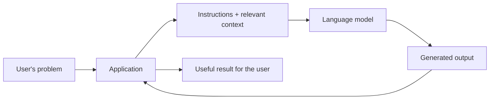

# 01 · Introduction to Prompt Engineering

> **Big idea:** A language model produces a continuation of the information it receives. Prompt engineering is the practice of making that continuation useful, relevant, and reliable.

**Reading time:** ~10 minutes · **Focus:** history, attention, transformers, and the role of a prompt

---

## The central question

Imagine giving a language model the words:

> *The most important discovery of the experiment was…*

Many continuations are possible. The model could finish a scientific report, invent a dramatic story, or produce a short summary. **The words surrounding the request determine which kind of continuation is likely.**

That is the starting point of **prompt engineering**: designing the instructions, examples, and context so that the model's output serves a particular purpose.

It is not simply the art of asking a clever question. In an application, prompt engineering also means deciding **what information to retrieve, how to structure a conversation, and what to do with the result**.

## 1. How did we get here?

The path from early language models to conversational assistants can be understood as a sequence of solutions to information-processing problems.

| Era | Key development | What changed? |
|:---|:---|:---|
| **1940s onward** | Statistical language models and Markov-style approaches | Predict text from a limited preceding context. |
| **2014** | Sequence-to-sequence (**seq2seq**) models | Translate or transform one sequence into another with an encoder and decoder. |
| **2015** | Attention in neural sequence models | Allow a decoder to access relevant portions of the input rather than relying on one compressed representation. |
| **2017** | The **Transformer** architecture | Use attention as the central mechanism for representing relationships within a sequence. |
| **2018** | **GPT**: Generative Pre-trained Transformer | Pretrain a transformer-based text generator, then adapt it to useful tasks. |
| **GPT-2 → GPT-3 → GPT-4** | Increasingly capable language models | Prompting becomes an important way to perform tasks without training a new model for each one. |

> **Remember:** The transformation was not from “predicting words” to an entirely different principle. It was from **simple predictions with limited context** to **powerful context-sensitive prediction**.

## 2. The original challenge: a sentence is not a single vector

An early **seq2seq translation model** had two main components:

1. An **encoder** reads the source sentence and compresses it into a fixed-size representation, sometimes called a *thought vector*.
2. A **decoder** uses that representation to generate the translated sentence, one token after another.

```text
Source sentence → Encoder → [compressed representation] → Decoder → Translation
```

This works reasonably well for short input. But try compressing an entire paragraph into one small representation while preserving every name, qualification, and grammatical relationship.

**The bottleneck:** important details can be lost before the decoder has finished its job.

### Attention changes the picture

Instead of using only the final compressed vector, the decoder can consult multiple representations of the source words. At each output step, it places different *weights* on different parts of the input.

For example, while translating **“The scientist opened the laboratory door,”** the decoder can concentrate on the source words relevant to the next translated word.

| Without attention | With attention |
|---|---|
| One summary must carry most input information. | The decoder can consult a collection of source representations. |
| Details can disappear in long sequences. | Different source words can become important at different output steps. |
| A narrow information bottleneck. | More flexible access to context. |

The idea is surprisingly intuitive: **not every input word matters equally at every moment**.

## 3. The transformer: attention becomes the architecture

The 2017 paper *Attention Is All You Need* introduced the transformer. Instead of relying on recurrent processing to move through a sequence, the transformer uses attention to connect information between token positions.

This design made training on large text collections more practical and allowed models to represent rich relationships across text.

### What does GPT mean?

| Letter | Meaning | In plain language |
|:--:|---|---|
| **G** | Generative | Produces new content. |
| **P** | Pre-trained | Learns broadly from large datasets before being adapted for particular uses. |
| **T** | Transformer | Uses transformer layers, including attention, to process context. |

GPT-style text generation is usually **autoregressive**. Given tokens $t_1, \ldots, t_n$, the model estimates the distribution of the next token:

$$
P(t_{n+1}\mid t_1,t_2,\ldots,t_n).
$$

It selects one token, appends it to the sequence, and repeats.

This simple-looking operation can produce answers, explanations, code, translations, and stories because the model has learned many forms of structured text.

## 4. A prompt is more than a question

Consider two requests for the same task.

**Vague:**

```text
Explain transformers.
```

**Designed:**

```text
Explain the transformer architecture to first-year computer science students.
Begin with the problem faced by seq2seq models, then introduce attention.
Use one simple analogy, one comparison table, and no more than 300 words.
Define any technical term before using it.
```

The second prompt does four things the first does not:

- states the **audience**;
- supplies the **scope and sequence**;
- specifies the **presentation format**;
- sets **constraints** on length and terminology.

This is the difference between hoping for a good completion and **designing the conditions for one**.

## 5. From a prompt to an application

When someone uses a simple chatbot, it may seem as though there are only two participants: a person and a model. In a real application, there is often a third participant: **the application itself**.



The application may retrieve supporting documents, maintain conversation history, validate the answer, format it, or call an external tool. Prompt engineering is therefore closely connected to **application design**.

### Where the engineering happens

| Layer | A useful design question |
|---|---|
| **Task** | What exactly is the user trying to accomplish? |
| **Instructions** | What behavior, style, and format are needed? |
| **Context** | What facts or documents must the model receive? |
| **Interaction** | Is this a single response or a longer conversation? |
| **Output handling** | How will the result be checked, displayed, or used? |

## 6. The three limitations worth remembering

**A language model is not automatically a search engine.** It can produce plausible text without having retrieved or verified a source.

**Context is finite.** A model processes only the content available to it within its supported context limit. This makes selecting and compressing information an engineering decision.

**Fluent does not mean correct.** A well-written explanation can still contain factual or logical errors. Verification matters most when errors have consequences.

These limitations lead naturally to later topics: *tokenization, sampling, chat alignment, retrieval-augmented generation, and tool use*.

---

## At a glance

| Concept | One-sentence definition |
|---|---|
| **Language model** | A system that models patterns in sequences and can generate plausible continuations. |
| **Seq2seq** | An encoder–decoder approach for converting one sequence into another. |
| **Attention** | A mechanism for weighting information from relevant token positions. |
| **Transformer** | A neural architecture built around attention and layered representations. |
| **GPT** | A generative, pre-trained model based on the transformer architecture. |
| **Prompt engineering** | Deliberately designing instructions, context, and interactions to produce useful model behavior. |

### Five takeaways

1. Modern language models grew out of a long history of sequence prediction.
2. Attention addresses the limits of compressing input into a single fixed representation.
3. Transformers made attention central to processing language.
4. GPT-style models generate text by repeatedly predicting the next token.
5. A useful prompt connects a **user's goal** to the **kind of output** the model should produce.

### Check your understanding

- Why was a single *thought vector* problematic for long input sequences?
- What changes when the decoder can use attention?
- Which parts of a well-designed prompt are missing from “Explain transformers”?

**Next:** [02 · Understanding Language Models](02-understanding-llms.md)
