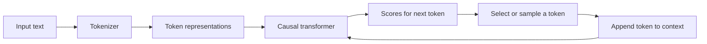

# 02 · Understanding How Language Models Work

> **Big idea:** To use a language model well, understand what it actually processes: **tokens, probability distributions, and context**. Many prompting mistakes become much easier to diagnose once these three ideas are clear.

**Reading time:** ~17 minutes · **Focus:** tokenization, generation, temperature, attention, and hallucinations

---

## The whole mechanism in one picture

A simplified GPT-style generation loop looks like this:



Nothing in this loop directly guarantees that a statement is true. The model learns statistical and semantic patterns in its training process, then uses those patterns to produce the next token under the current context.

## 1. A language model continues a sequence

A base language model can be viewed as a **text-completion engine**. Given:

> *Yesterday, my TV stopped working. Now I can't turn it on at…*

one very natural continuation is **“all.”** The completed sentence is grammatical because the model has learned what kinds of words tend to occur together.

The continuation after that is less predictable. The text might become a personal story, a request for help, or a troubleshooting guide.

**Why this matters:** the prompt does not merely specify a topic. It also creates an expectation about the **type of document or response** that should follow.

Modern assistant systems can add instructions, reasoning processes, retrieval, and tools around this generation mechanism. The underlying next-token perspective is still a useful starting point.

## 2. Tokens: the model's units of text

People see words and sentences. Text-based language models operate on **token IDs**.

A tokenizer converts text into pieces that may represent whole words, word fragments, punctuation, or whitespace-attached units. The exact segmentation depends on the tokenizer.

| Human-readable text | Possible tokenization pattern |
|---|---|
| `cat` | One token |
| `unbelievable` | Several subword tokens |
| `.` or `,` | Often an individual punctuation token |
| Uncommon spelling | Often broken into more pieces |
| A change of capitalization or spacing | Can change token boundaries |

*These are illustrations, not tokenizations guaranteed by a particular model.*

### Three practical consequences

**1. Character-level tasks can be surprisingly difficult.** Anagrams, spelling puzzles, and exact letter counts are not always easy for a system trained on subword units.

**2. Formatting has a cost.** Code fences, Markdown punctuation, repeated examples, and prior conversation turns all occupy space in the context.

**3. Different languages may use different numbers of tokens.** A 500-word passage is not necessarily 500 tokens, and its token count can differ considerably between languages and tokenizers.

> **Try it:** Compare the token counts of a short English paragraph, its Polish translation, and the same text with unusual spacing. The number of words may stay similar while the number of tokens changes.

## 3. The context window is finite

The **context window** is the amount of tokenized information a model can consider in a request. It may contain:

- system-level and application instructions;
- the current user message;
- earlier conversation turns;
- documents, examples, and retrieved passages;
- sometimes space reserved for the generated output.

The slide material uses **GPT-3.5 at roughly 4,000 tokens** and **GPT-4 Turbo at 128,000 tokens** as historical examples. Those figures are **not universal or current limits for all models**.

A long prompt is not automatically a good prompt. Extra information can make the relevant facts harder to identify.

### A context-budget mindset

| Include first | Include only if relevant | Usually remove |
|---|---|---|
| The task and desired result | Representative examples | Repeated instructions |
| Essential facts and constraints | Earlier conversation details | Unrelated background |
| Source excerpts needed for accuracy | Style demonstrations | Redundant or low-value passages |

In long-running conversations, an application may shorten old history or summarize it. Whether this happens depends on the application rather than on an automatic rule shared by every model.

## 4. Autoregression: one token at a time

**Autoregressive generation** means that the next token is conditioned on the preceding sequence.

```text
The cat sat on the → [mat] → [.] → [end]
```

The model does not first write an entire finished paragraph and then reveal it. Each new token becomes part of the context for subsequent tokens.

This has two consequences:

- **Early choices matter.** A poor beginning may steer later sentences toward an unhelpful direction.
- **Repetition can reinforce itself.** Once a repetitive pattern appears, subsequent tokens may continue it.

A single forward generation pass cannot directly edit already-emitted tokens. However, a surrounding application can make additional model calls, request revisions, or use tools to check and rewrite a result.

## 5. How is the next token chosen?

For any position, the model produces numerical scores—**logits**—for candidate tokens. A **softmax** function converts these scores into probabilities.

For a deliberately simplified example:

> *The cat sat on the…*

| Possible next token | Illustrative probability |
|---|---:|
| `mat` | 0.52 |
| `sofa` | 0.28 |
| `floor` | 0.15 |
| `moon` | 0.05 |

Two common selection strategies are:

- **Greedy decoding:** select the highest-scoring token at each step.
- **Sampling:** randomly select a token according to its probability, allowing different outputs from the same prompt.

The probabilities in the example are invented for explanation, not measured from a particular model.

### Temperature: reshaping probabilities

A common mathematical description is

$$
p_i(T)=\frac{\exp(z_i/T)}{\sum_j\exp(z_j/T)},
$$

where $z_i$ is the logit of token $i$ and $T>0$ is the temperature.

- **Lower temperature:** concentrates probability on already likely candidates.
- **Higher temperature:** makes less likely candidates easier to sample.
- **Near zero:** approaches greedy selection in many implementations.

| Task | Typical teaching heuristic | Trade-off |
|---|---|---|
| Factual extraction, concise summaries | **0.0–0.3** | More stable phrasing; not a guarantee of truth. |
| Ordinary writing and dialogue | **0.5–0.8** | More variation in wording and tone. |
| Creative ideas and storytelling | **0.9–1.3** | More variety, with greater risk of incoherence. |
| Experimental generation | **Above 1.3** | Highly variable and often unstable. |

These ranges are **illustrative guidelines from the teaching material**. Available settings, defaults, and their effects vary across systems.

> **Important distinction:** Low temperature makes an answer **more predictable**, not necessarily **more accurate**.

## 6. Transformers and self-attention

A transformer represents the text as a sequence of vectors and updates those vectors through multiple layers. One of its central mechanisms is **self-attention**.

For intuition, think of three pieces of information:

| Component | Informal question |
|---|---|
| **Query (Q)** | What information am I looking for? |
| **Key (K)** | What information could this token help identify? |
| **Value (V)** | What information should be passed along? |

A token can compare its **query** with the **keys** of other relevant tokens and combine their **values** using attention weights.

Consider:

> *Susan entered the room. She placed her notes on the table.*

When processing “She,” a useful representation may draw strongly on the earlier mention of “Susan.” Attention provides a way to connect those positions.

### Why the model cannot simply look ahead

In a **causal decoder**, attention uses a mask so that a token position cannot access future token positions during ordinary autoregressive prediction.

```text
Position:       1    2    3    4
Can attend to:
1               ✓    ·    ·    ·
2               ✓    ✓    ·    ·
3               ✓    ✓    ✓    ·
4               ✓    ✓    ✓    ✓
```

The triangular pattern is the source of the terms **causal masking** and **left-to-right generation**.

The network also processes information through successive layers, building increasingly contextual representations. Calling each position a “mini-brain” may help as a metaphor, but in engineering terms these are vector operations in shared neural-network layers, not independent little agents.

## 7. Why reading and writing have different costs

When processing a supplied prompt, many token positions can be computed **in parallel**. This phase is often called *prefill*.

When generating output, each newly produced token depends on the earlier tokens. This phase is **sequential**, even though individual steps can use highly parallel numerical operations.

| Phase | Typical character |
|---|---|
| **Prompt processing** | Parallel processing of the available input sequence. |
| **Output generation** | Repeated next-token steps, with new text appended at each step. |

This distinction helps explain why both a very long input and a very long generated answer can affect latency and cost.

## 8. Hallucinations: when fluent text is wrong

A **hallucination** is an output that contains invented, unsupported, or false information presented as if it were reliable.

| Type | Example failure |
|---|---|
| **Factual** | A wrong date, person, measurement, or event. |
| **Logical** | A conclusion contradicts the evidence in the prompt. |
| **Structural** | A fabricated citation, URL, document title, or API endpoint. |

A particularly dangerous case is a plausible-looking reference: the model can generate a URL that has the *shape* of a genuine source without the source existing.

### Better defenses than simply asking for confidence

1. Supply relevant, trustworthy **source material**.
2. State what the model should do when the source **does not contain the answer**.
3. Use retrieval or tools when the task depends on **current or private facts**.
4. Verify critical values, links, citations, and calculations **outside the language model's prose**.
5. Prefer smaller, testable subtasks over one ambiguous, oversized request.

Even a cautious, well-aligned chat model can make errors. Expressed confidence is not a substitute for evidence.

---

## Quick comparison

| Term | Meaning | Why you care |
|---|---|---|
| Tokenization | Turning text into token IDs | Affects formatting, costs, and exact-text tasks. |
| Context window | Model's supported amount of input/context | Makes selecting information essential. |
| Autoregression | Generating the next token from earlier ones | Explains sequential output and cascading mistakes. |
| Logits and softmax | Turning scores into a probability distribution | Explains how candidate tokens are ranked. |
| Temperature | Controls the sharpness of that distribution | Balances variation with predictability. |
| Self-attention | Context-dependent information exchange | Connects related words and ideas. |
| Causal masking | Prevents access to future positions in generation | Preserves left-to-right prediction. |
| Hallucination | Plausible but unsupported or false content | Requires grounding and verification. |

### What to remember

**Tokens are not words. Probabilities are not facts. Fluency is not verification.** With these distinctions in mind, prompt engineering becomes much less mysterious.

### Check your understanding

1. Why might a simple character-counting task be difficult for a language model?
2. How do greedy selection and sampling differ?
3. Why does lower temperature *not* guarantee factual accuracy?
4. What information does causal masking hide from a token position?
5. Which kind of hallucination can produce a plausible but nonexistent URL?

**Next:** [03 · Chat Models and Human Feedback](03-chat-models.md)
