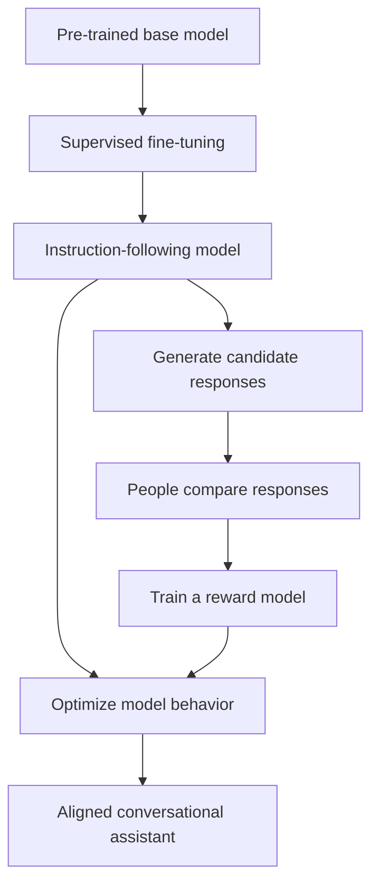

# 03 · Chat Models, Human Feedback, and Tools

> **Big idea:** A base language model can complete text. A **chat assistant** is a language model trained and packaged to participate in a structured conversation, follow instructions, and cooperate with tools.

**Reading time:** ~15 minutes · **Focus:** SFT, RLHF, message roles, chat structure, and tool calls

---

## From “continue this text” to “help me with this task”

Suppose we begin with:

```text
What is a good indoor activity for a family of four?
```

A base model might continue this as part of a questionnaire, a blog post, or a list of possible questions. What the user wants, however, is an **answer**.

The evolution from base models through *instruction-tuned* models to *chat models* addresses exactly this mismatch.

| Type of model | Typical behavior | Main challenge |
|---|---|---|
| **Base/completion model** | Continues a text sequence. | May continue the *document* rather than answer the question. |
| **Instruction-tuned model** | Responds to requests in useful formats. | Has a weaker explicit structure for multi-turn dialogue. |
| **Chat model** | Processes messages with roles and conversational context. | Still needs grounding, careful instructions, and safe tool handling. |

Chat is not a completely different mathematical species of model. The underlying generator is still predicting tokens; **training and message formatting change the kind of continuation it learns to produce**.

## 1. What is alignment trying to accomplish?

The training objective of a base language model is not the same as the objective of a helpful assistant. A general training corpus contains excellent explanations, inaccurate claims, arguments, jokes, dangerous advice, and conflicting styles.

A practical assistant should generally be:

- **Helpful:** respond to legitimate user goals.
- **Honest:** avoid unsupported claims and acknowledge uncertainty.
- **Harmless:** avoid contributing to unnecessary harm.

These goals are sometimes summarized as **HHH alignment**.

A well-aligned assistant is not merely a model that produces pleasant prose. The aim is to make its *behavior* more suitable for conversation and decision support.

## 2. The training pipeline: SFT → feedback → RLHF

The lectures describe the classical reinforcement-learning-from-human-feedback pipeline.



### Stage A · Supervised fine-tuning (SFT)

Human-written or carefully selected examples show the model what a useful response looks like.

```text
User: Explain a black hole to a twelve-year-old.
Assistant: Imagine a place where gravity is so strong that even light cannot escape…
```

Instead of learning *any plausible continuation*, the model learns the patterns of a **good assistant response**.

**Strength:** clearer instruction following.  
**Limit:** examples alone do not ensure correctness or good judgment in every situation.

### Stage B · Human preference comparisons

For one prompt, an SFT model generates several candidate answers. Human evaluators compare them, for example:

| Candidate | Possible evaluation |
|---|---|
| A | Relevant and accurate, but a little lengthy. |
| B | Confident and polished, but contains an invented fact. |
| C | Correct, clear, and appropriately cautious. |

The comparison is more informative than asking people to write a perfect answer from scratch every time.

### Stage C · Reward model

A **reward model** learns to estimate which outputs humans are likely to prefer. It assigns scores that can guide later optimization.

The reward is not the same as an objective test of truth. Human preferences may be incomplete, inconsistent, or affected by presentation style.

### Stage D · Reinforcement learning

The instruction-following model is further optimized using the learned preference signal. The slide material highlights **PPO (Proximal Policy Optimization)** as a classical method for this stage.

A key engineering concern is **reward hacking**: optimizing for the reward model's score instead of the real quality people care about.

### Historical scale, not a specification

The teaching slides give an illustrative early InstructGPT-era comparison:

| Stage | Example scale shown in the lectures |
|---|---:|
| Base language-model corpus | About **499 billion tokens** |
| SFT demonstration dataset | About **13,000 examples** |
| Reward-model preference data | About **33,000 prompt/response records** |
| RLHF training data | About **31,000 records** |

These are **historical teaching figures** from a particular pipeline, not a description of how every present-day chat model is trained.

## 3. Benefits and trade-offs of RLHF

The goal is not to make a model superficially agreeable. Useful improvements can include better instruction following, appropriate refusals, and more calibrated expressions of uncertainty.

There are also trade-offs:

- **Preference bias:** a small group of annotators may influence the model's style.
- **Reward-model limitations:** a numerical score may miss subtle factual errors.
- **Alignment tax:** optimization for assistant-like behavior may weaken some capabilities or reduce flexibility in other tasks.
- **No absolute guarantee:** training reduces some problematic behaviors but does not eliminate errors.

This is why **evaluation** remains an essential part of the application lifecycle.

## 4. Chat messages have roles

A conversation is not simply one long, unlabeled piece of text. Chat-oriented interfaces associate messages with roles.

| Role | Main purpose |
|---|---|
| **System** | High-level instructions and application behavior. |
| **User** | The person's request or follow-up. |
| **Assistant** | Replies, including intermediate tool requests where supported. |
| **Tool** | Results returned by an external service or function. |

Roles reduce ambiguity. A model can distinguish a user's request from an earlier assistant response or an external tool result.

### ChatML: a way to visualize structured dialogue

The slides introduce **ChatML** (Chat Markup Language) and special message-boundary tokens. A simplified representation looks like this:

```text
<|im_start|>system
You are a concise study assistant.
<|im_end|>
<|im_start|>user
Explain the difference between RAM and storage.
<|im_end|>
<|im_start|>assistant
RAM holds data needed for active work; storage keeps data longer term.
<|im_end|>
```

This is a **conceptual illustration of a chat transcript**. Exact token conventions and API formats depend on the model provider and version.

The important idea is **role separation**, not memorizing one particular set of delimiters.

> **Safety note:** Structured messages help establish instruction boundaries, but they do **not** make an application immune to prompt injection. Content retrieved from documents or tools must still be treated as potentially untrusted.

## 5. Chat and completion: different interfaces, different strengths

| Property | Raw completion-style workflow | Chat-style workflow |
|---|---|---|
| Main input | A text prefix | A sequence of role-labeled messages |
| Natural behavior | Continue the text | Produce an assistant response |
| Multi-turn structure | Must be designed manually | Explicit message boundaries |
| Style control | Examples and prompt structure | Role instructions plus examples |
| Ending the output | Often needs a stop condition | Usually has message-level completion handling |
| Main engineering issue | Making a continuation look like the intended output | Managing context, priorities, and trustworthy actions |

Chat interfaces simplify many ordinary tasks, but **they do not remove the need for prompt design**.

## 6. The parameters behind a chat response

The following parameters appear in the lecture examples. Availability and exact names differ across current APIs and models.

| Parameter | What it controls or reports | Why it matters |
|---|---|---|
| `max_tokens` or equivalent | Output-length budget | Prevents unexpectedly long generations. |
| `temperature` | Sampling randomness | Controls variation in supported models. |
| `stop` | Stop sequences | Useful for bounded text formats. |
| `stream` | Incremental response delivery | Shows output as it is produced. |
| `n` | Number of candidate outputs | Allows comparing alternatives where supported. |
| `logprobs` | Log-probabilities of tokens | Helps examine token-level scores. |
| `top_logprobs` | Scores of alternative tokens | Reveals alternatives at a generation step. |
| `logit_bias` | Adjustments to selected token scores | Fine-grained control where exposed. |

**Two cautions:** token probabilities are not a calibrated measure of factual truth, and generating more candidates generally uses more computation/output resources.

## 7. The application can extend the conversation with tools

Think of two interleaved conversations:

1. **Visible conversation:** what the user asks and what the assistant says.
2. **Application–model conversation:** instructions, retrieved context, tool descriptions, tool results, and intermediate messages.

This enables workflows that cannot be solved reliably from training data alone.

### Example: checking a current train departure

```text
User: When is the next train?
       ↓
Model: Request a timetable lookup.
       ↓
Application: Execute the timetable API call.
       ↓
Tool: Return current departure information.
       ↓
Model: Explain the result to the user.
```

The model **requests** the action. The surrounding software **executes** the API call and supplies the result back to the model.

Tools can be **read-only** (search, retrieve, check) or **write-capable** (save, edit, reserve). Write-capable tools need stronger permissions, validation, and user confirmation for consequential actions.

### A practical scenario: a code assistant

Suppose the user says:

```text
This code does not work. What is wrong?
```

But the code lives in an attached file. An application can retrieve the relevant section and include it as context:

```python
for i in range(100):
    print i
```

The assistant can then explain that `print i` is Python 2 syntax and that Python 3 expects `print(i)`.

**Lesson:** the user's message alone may not contain everything the model needs. The application is responsible for assembling a complete, relevant context.

## 8. Writing a useful chat instruction

A good application-level instruction usually defines:

- the assistant's **job**;
- the intended **audience**;
- the **available information and tools**;
- what to do if information is **missing**;
- the **expected output format**.

**Example:**

```text
You are a technical support assistant for beginner users.
Use the documentation provided in the conversation.
Provide no more than five numbered troubleshooting steps.
If the documentation does not support a claim, say what is unknown.
Do not claim that you changed any settings unless a tool confirms it.
```

This is more valuable than a vague command to “be very intelligent.” It is *testable* and *operational*.

---

## The shortest useful summary

**Base model → instruction tuning → preference alignment → structured chat → tool-using application.**

| If you remember only one thing about… | Remember this |
|---|---|
| **SFT** | Demonstrates what good assistant answers look like. |
| **RLHF** | Uses preferences to improve assistant behavior. |
| **Chat roles** | Tell the model who is speaking and what kind of content it is reading. |
| **Tool calls** | The application performs real actions; the model selects and interprets requests/results. |
| **Safety and reliability** | Training and role labels help, but do not replace verification or permission checks. |

### Check your understanding

1. Why might a base model continue a questionnaire rather than answer a question?
2. How does a reward model differ from a supervised example?
3. What does a message role contribute to a chat transcript?
4. Who actually runs an API call: the model or the application?
5. Why is a confident assistant response not necessarily a verified one?

**Next:** [04 · Designing LLM Applications](04-designing-llm-applications.md)
