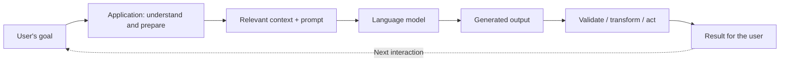
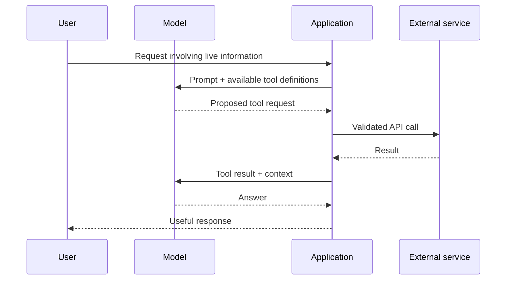

# 04 · Designing Applications with Language Models

> **Big idea:** The model produces text; the **application** turns a real-world problem into the right model input and turns the output into a useful result. Good applications are built around this transformation.

**Reading time:** ~17 minutes · **Focus:** application loops, prompt assembly, context, tools, and evaluation

---

## 1. Think in loops, not isolated prompts

A simple prompt is one interaction. An LLM application is a process:



The application is the bridge between two worlds:

- **User domain:** documents, problems, preferences, appointments, code, real-world decisions.
- **Model domain:** tokenized input, instructions, context, and generated output.

A proofreading assistant might need only one pass. A travel assistant may require many steps, external services, and remembered preferences.

## 2. Four dimensions of application complexity

The slides compare three illustrative applications.

| Dimension | Text proofreading | IT support | Travel planning |
|---|---|---|---|
| **Medium** | Typed text | Possibly spoken interaction | Web interface, text, and APIs |
| **Abstraction** | One bounded task | Many possible technical causes | Many competing requirements |
| **Context** | Usually the user's text | Documentation, device details, history | Preferences, dates, budgets, external data |
| **State** | Often independent requests | History of attempted fixes | A plan evolving across many interactions |

**Design principle:** as abstraction, external context, and state increase, the application must do more than forward a user message to a model.

## 3. Four requirements of an effective prompt

The lectures organize prompt quality around four criteria:

1. **A familiar format.** Structure the prompt like a recognizable task, document, or dialogue. The material describes this as the *Little Red Riding Hood principle*: familiar patterns make the expected continuation easier to infer.
2. **Enough relevant information.** Supply what is necessary to solve the problem, while avoiding a flood of unrelated details.
3. **A clear direction.** Tell the model what it should accomplish and how the answer should begin or be organized.
4. **A controlled stopping point.** Define the output's scope so that the model knows when it is finished.

These criteria can be checked separately. For example, a prompt may have perfect formatting but still lack the data required for an accurate answer.

### From weak to operational

**Weak request:**

```text
My computer is slow. Help.
```

**Better task definition:**

```text
# Goal
Create a beginner-friendly troubleshooting plan for a slow Windows computer.

# Observations
- Performance deteriorated over the last few days.
- Windows 10 is installed.
- The system was updated one week ago.
- Browser, document editor, and messaging app are often open.
- The fan is louder than usual.

# Requirements
- Suggest at most five safe diagnostic steps.
- Cover CPU load, RAM usage, disk space, and background processes.
- Give a brief explanation of what each observation could indicate.
- Do not recommend destructive changes or assume a cause without evidence.
```

This prompt makes the task answerable and limits potentially unhelpful advice.

## 4. Feedforward: preparing the model's input

In the architecture discussed in the slides, a **feedforward pass** is the application's preparation pipeline that transforms an incoming problem into a prompt. This is an **application-level term** here, not the transformer's internal feed-forward neural-network block.

A useful four-stage breakdown is:

| Stage | What happens? | Example |
|---|---|---|
| **Context retrieval** | Collect useful information. | Read the relevant support article. |
| **Snippetization** | Split long material into manageable excerpts. | Extract the paragraph about fan noise. |
| **Prioritization** | Rank pieces by usefulness and relevance. | Device-specific instructions before generic tips. |
| **Prompt assembly** | Combine task, constraints, and context. | Build the final troubleshooting request. |

```text
User request
   ↓
Collect context (user information + relevant documents)
   ↓
Convert / split material into useful snippets
   ↓
Rank and select snippets within a context budget
   ↓
Assemble the prompt
   ↓
Call the model
```

### Where does context come from?

**Direct context** is supplied by the user, such as a document to summarize.

**Indirect context** comes from other relevant resources, such as a knowledge base, API, or conversation history.

**Boilerplate** is the stable text that ties the input together: role instructions, required output structure, and reusable constraints.

Boilerplate is not a substitute for evidence. It provides the *frame* in which retrieved or supplied facts should be interpreted.

## 5. Managing a finite context budget

More context is not always better. A large document can contain many relevant-looking but distracting passages.

A sensible selection policy considers:

- **Relevance:** does the excerpt address the current question?
- **Priority:** is it essential or merely nice to have?
- **Freshness:** might its information have changed?
- **Duplication:** does another excerpt already say the same thing?
- **Cost:** how many tokens and how much retrieval time does it consume?

For a long conversation, the application may retain the most recent messages and compress older exchanges into a structured summary. This avoids treating every earlier sentence as equally valuable.

> **Useful practice:** Keep a compact record of the user's goal, confirmed facts, decisions already made, and unresolved questions. These often matter more than the entire chat transcript.

## 6. Choosing a model is an engineering decision

Models differ in quality, latency, capacity, and cost. Choosing the largest available model for every operation is rarely a complete design strategy.

| Objective | Possible design choice |
|---|---|
| Minimize response time | Use a faster model or precompute stable context. |
| Improve quality on a complex task | Use a more capable model and stronger source grounding. |
| Reduce cost | Keep prompts focused and avoid unnecessary repeated calls. |
| Improve a narrow specialized workflow | Evaluate task-specific tuning or task decomposition. |

A larger model may help, but **poorly selected context can still undermine the result**.

## 7. Converting model output into something useful

A model's output might be a paragraph, JSON, a code snippet, or a proposal for a tool call. The application must decide what happens next.

Examples:

- **Document assistant:** render a summary with source links.
- **IT assistant:** display safe, ordered troubleshooting steps.
- **Calendar assistant:** turn a structured request into a validated event proposal.
- **Code assistant:** check generated code with tests before suggesting it for use.

The key separation is between **generating a proposed result** and **performing an external action**.

## 8. More advanced loops: state, retrieval, and reasoning

### Stateful conversations

One-shot applications can discard the entire context after delivering an answer. Stateful applications preserve useful history:

```text
Question 1 → Answer 1
      ↓
Question 2 + relevant history → Answer 2
      ↓
Question 3 + updated state → Answer 3
```

State can include conversation summaries, prior tool results, user decisions, and the status of a task.

### Retrieval-augmented generation (RAG)

When facts reside in external or private documents, an application can retrieve relevant excerpts **before** asking the model to answer.

```text
Question → Retrieve documents → Select excerpts → Ask model → Grounded answer
```

Retrieval may use keyword indexes or semantic vector search. A query can be taken directly from the user or reformulated to improve search.

**RAG does not guarantee accuracy:** retrieving the wrong document or misreading the right one can still produce a poor answer.

### Breaking difficult tasks into stages

A complex task often improves when the application requires explicit intermediate *outputs*, such as:

1. identify constraints;
2. gather evidence;
3. compare alternatives;
4. check the result against the constraints;
5. produce a concise final recommendation.

This is a practical use of stepwise prompting or task decomposition. The output steps should be verifiable; simply generating a long explanation is not proof of correctness.

## 9. Tools give applications access to the outside world

A language model on its own cannot inspect a user's live timetable or write a file on an external server. An application can provide **tools** with defined names, parameters, permissions, and return values.



### Read-only tools versus world-changing tools

| Read-only | Write-capable |
|---|---|
| Search documentation | Update a document |
| Retrieve current information | Create a calendar event |
| Check an order's status | Place or modify an order |
| Look up code examples | Open a pull request |

Write-capable tools require stricter confirmation, permissions, and checks. The model can propose arguments, but the application must validate and execute them.

### ReAct-style interaction

The slides discuss **ReAct** as an iterative pattern joining reasoning about the task with external action. A simplified version is:

```text
Identify the next question → Call search/lookup → Read the result
           ↑                                      ↓
           └──────── Decide whether more evidence is needed
```

A tool loop is useful when the answer cannot be prepared from a single static prompt.

## 10. Evaluate the entire application

Good-sounding answers are not enough. An LLM application should be evaluated for actual utility, factual reliability, and user outcomes.

### Offline evaluation: before release

Run a fixed set of test cases and compare systems under controlled conditions. Possible measures include:

- accuracy against verified answers;
- success of generated code on tests;
- adherence to format and constraints;
- quality of retrieved evidence;
- time and cost per task.

Some tasks can be evaluated automatically. Others require human assessment or carefully designed model-assisted grading.

> **Important:** Test the **whole pipeline**, not only the final model call. A failure in retrieval or prompt assembly can dominate the result.

### Online evaluation: in real use

Measure how people actually interact with the application. The lectures emphasize telemetry and meaningful indirect signals.

| Observable signal | Possible meaning | Why interpretation is tricky |
|---|---|---|
| Positive/negative rating | User satisfaction | Not all users provide feedback. |
| Suggested code accepted | Suggestion may be useful | Users may later modify or revert it. |
| A calendar event successfully created | A concrete outcome occurred | The event may still need correction. |
| Very short session | The task finished quickly | Or the user abandoned the system. |

**Measure success in the user's domain, not merely how elegant the text looks.**

---

## Application design checklist

Before releasing an LLM feature, verify:

- [ ] The user problem and expected outcome are clearly defined.
- [ ] Necessary context is available and unrelated material is excluded.
- [ ] Prompt structure and stopping behavior are specified.
- [ ] The model and workflow fit latency, cost, and quality requirements.
- [ ] Long conversations have an explicit state-management strategy.
- [ ] Tool calls have validation and appropriate permissions.
- [ ] Failures can be detected, explained, and recovered from.
- [ ] Both offline tests and real-world outcome metrics exist.

### Five takeaways

1. An LLM application is a **transformation loop**, not just a prompt.
2. Context retrieval, selection, and assembly are core responsibilities of the application.
3. State, RAG, and tools enable more demanding workflows.
4. External actions require additional validation and controls.
5. The right evaluation target is **successful task completion**, not persuasive prose.

**Next:** [05 · Prompt Content and Retrieval](05-prompts-context-and-rag.md)
