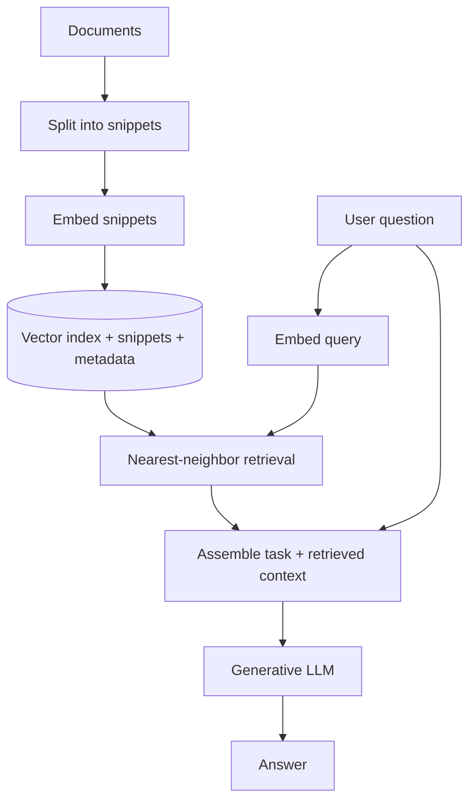

# 05 · Prompt Content, Context, and Retrieval-Augmented Generation

> **Big idea:** The quality of an LLM response depends not only on the instruction, but also on **which information enters the prompt**. The engineering challenge is to find, prioritize, and present the most useful context.

**Reading time:** ~22 minutes · **Focus:** static and dynamic content, few-shot prompting, retrieval, embeddings, and RAG architecture

---

## Start with a familiar problem: recommending a book

Imagine an assistant that receives only this information:

> *My last three books were A, B, and C. What should I read next?*

It can offer plausible recommendations, but they may be generic. Now imagine it also knows that the reader likes historical fiction, dislikes self-help books, prefers shorter novels, and has recently enjoyed stories set in South America.

**The recommendation problem has not changed. The available context has.**

This is the core lesson of this chapter: a language model can make good use of diverse text, but an application must first make the appropriate text available.

## 1. Two types of prompt content

The lectures distinguish **static** and **dynamic** context.

| Static content | Dynamic content |
|---|---|
| Defined as part of the application or task design. | Obtained for a specific user, case, or interaction. |
| Usually changes relatively rarely. | May change from one request to the next. |
| Describes the job, constraints, or output format. | Describes recent behavior, preferences, or external facts. |
| Example: “Recommend books for leisure reading.” | Example: “The user finished a mystery novel yesterday.” |

### A subtle but important point

The **same sentence** can be static or dynamic depending on how an application uses it.

> *Avoid recommending self-help books.*

- If this is a fixed rule applied to all users, it is **static**.
- If it came from one user's preference history, it is **dynamic**.

The distinction describes **where the information comes from and how it changes**, not merely its grammatical form.

### A useful prompt blueprint

```text
# Task
Recommend three books for leisure reading.

# General instructions
Give a brief reason for each recommendation.
Avoid repeating books the user has already read.

# User context
Likes: historical fiction, strong characters.
Dislikes: self-help books.
Recently enjoyed: [list of actual titles].

# Output
A table with Title | Why it fits | Possible drawback.
```

The context fields should contain **real user data**, not guessed preferences.

## 2. Static instructions: tell the model what you need

Clear instructions reduce ambiguity. They typically answer:

- **What is the task?** Classify, recommend, summarize, compare, or explain?
- **What information is authoritative?** The supplied text, a retrieved document, or general background?
- **Who is the audience?** A child, a specialist, or a general reader?
- **What output is expected?** One sentence, a table, a structured object, or a plan?
- **What if something is missing?** Ask a question, explain uncertainty, or leave the field empty?

**Less effective:**

```text
Give me information about this book.
```

**More effective:**

```text
Summarize the book description in four sentences for a reader
who enjoys historical fiction. Use only the supplied description.
Mention the setting and central conflict. Do not reveal the ending.
```

### Explicit and implicit guidance

An instruction may be explicit (“use exactly three bullets”) or implicit (a formal example suggests a formal tone). Modern instruction-following models usually respond well to direct guidance, but **no model obeys every instruction perfectly in every situation**.

## 3. Zero-shot and few-shot prompting

**Zero-shot prompting** supplies an instruction without solved examples.

```text
Classify the sentiment as positive, neutral, or negative.
Text: “It was fine, but not especially memorable.”
```

**Few-shot prompting** adds examples that demonstrate the pattern.

```text
Text: “An excellent experience.”
Sentiment: positive

Text: “The service was terrible.”
Sentiment: negative

Text: “It was neither good nor bad.”
Sentiment: neutral

Text: “It was fine, but not especially memorable.”
Sentiment:
```

Examples can teach **style, format, labels, and task interpretation** without requiring a long verbal rulebook.

### Why examples help—and how they can mislead

| Benefit | Risk |
|---|---|
| Demonstrate a required output format. | Inconsistent examples create inconsistent outputs. |
| Show subtleties that are difficult to define. | Unrepresentative labels can bias the answer. |
| Reduce ambiguity in new task types. | Too many examples consume the context window. |
| Show how to handle edge cases. | Exceptional cases can become misleadingly prominent. |

The lectures identify two especially important failure modes.

**Scaling:** a long prompt containing examples for many users can become difficult to follow. The model may confuse where one example ends and another begins.

**Anchoring:** the model may infer an unintended distribution from the examples. If five example reviews have ratings 1, 2, 3, 4, and 5, it may behave as though those ratings should occur equally often in real data.

> **Rule of thumb:** Use a small, representative set of examples and include unusual cases only in proportion to their importance.

## 4. Dynamic context: useful, but not free

Dynamic information can improve personalization and accuracy, but obtaining it has a cost. The lectures emphasize three engineering criteria.

| Criterion | Question | Example |
|---|---|---|
| **Latency** | How quickly must the system respond? | Autocomplete needs a faster loop than an email digest. |
| **Preparability** | What can be computed or collected in advance? | A stable user profile may be cached. |
| **Comparability / priority** | Which data is more useful than other data? | A recent book preference may matter more than an old browsing event. |

### Urgency changes the strategy

| Application | Typical urgency | Practical implication |
|---|---|---|
| Background email summary | **Low** | More time for retrieval and preparation. |
| Book recommendation | **Medium** | Some retrieval and ranking may be acceptable. |
| Writing autocomplete | **High** | Context gathering must be fast and carefully limited. |

High-urgency applications often benefit from **simpler or precomputed context pipelines**.

### Two useful ways to classify sources

1. **Proximity to the application:** Is the data already in the app, in a connected service, or in a distant external source requiring additional access?
2. **Stability over time:** Is the information likely to remain valid for months, or could it change within minutes?

A user profile might be nearby and stable. Live stock prices are distant and quickly changing. The best retrieval strategy depends on **both dimensions**.

## 5. Finding context starts with the user's question

A good discovery method is to turn the original request into a **context map**.

For the question *“What should I read next?”*, useful branches might include:

```text
What should I read next?
├── Reading history
│   ├── Recently completed books
│   └── Ratings or reactions
├── Preferences
│   ├── Genres and themes
│   ├── Length and reading pace
│   └── Topics to avoid
├── Personal context
│   ├── Why the person is reading
│   └── Previous successful recommendations
└── Practical availability
    ├── Library / ebook access
    └── Language preference
```

The map describes a **possible ideal context**, not a demand to collect everything. Some information may be unavailable, intrusive, too expensive, or unrelated to the final recommendation.

### Prioritizing candidate context

The slides introduce the idea of **scoring** static and dynamic snippets. A practical assessment can use qualitative criteria:

- Is this information **relevant** to the task?
- Is it **reliable** and up to date?
- Is it **necessary** or just convenient?
- Does it **depend on** another fact?
- Does it **supersede or invalidate** older information?

A newer, explicit preference may replace an outdated inferred preference. It should not simply be piled onto the prompt alongside contradictory context.

## 6. Retrieval-Augmented Generation (RAG)

A language model's training alone may not include a company's internal documentation, a newly published article, or a private user's recent data.

**Retrieval-Augmented Generation** connects search and generation:

```text
User asks a question
       ↓
Search relevant information sources
       ↓
Select the most useful excerpts
       ↓
Add excerpts to the prompt
       ↓
Generate an answer grounded in that context
```

The most important design decision often happens **before the model begins writing**: *which passages should be retrieved?*

### Retrieval is not the same as answering

- **Retrieval:** find passages likely to contain the information.
- **Generation:** formulate an answer using the question and the retrieved passages.

A capable generator cannot reliably repair a retrieval step that selected irrelevant evidence.

The slides use a memorable analogy: **Chekhov's gun**. If the prompt introduces an irrelevant detail, the model may still treat it as important and force it into the answer.

> **Better retrieval is often more valuable than simply adding more retrieved text.**

## 7. Lexical retrieval: matching words

**Lexical retrieval** compares the terms in a query and a document. It is a classical information-retrieval technique, not an invention of the LLM era.

A basic pipeline is:

1. split documents into searchable passages;
2. normalize text and possibly remove common **stop words**;
3. optionally apply **stemming** or another normalization method;
4. compare passage terms with query terms;
5. rank the matches.

### Jaccard similarity

For two sets of terms, $A$ and $B$:

$$
J(A,B)=\frac{|A\cap B|}{|A\cup B|}.
$$

The score lies between **0** (no shared terms) and **1** (identical term sets), provided the union is nonempty.

**Example**

```text
Query terms:   {space, travel, novel}
Passage terms: {space, travel, novel, science}
```

The intersection has 3 elements; the union has 4:

$$J=3/4=0.75.$$

Jaccard is simple and transparent, but treats all terms equally. Other lexical approaches such as **TF–IDF** and **BM25** apply more informative weighting, often improving retrieval for realistic document collections.

### Where lexical search shines

- exact product names, identifiers, and error codes;
- queries whose wording closely matches documents;
- low-latency retrieval that is relatively easy to inspect and debug.

Its weakness is **vocabulary mismatch**: “car repair” and “automobile maintenance” can describe related topics without sharing the main content words.

## 8. Neural retrieval: matching meanings

**Neural retrieval** represents passages and questions as numerical vectors called **embeddings**.

The goal is for semantically related texts to occupy nearby regions of a high-dimensional vector space.

```text
“car repair” ───────┐
                    ├── nearby embeddings (ideally)
“automobile service”┘

“banana bread recipe” ─── farther away
```

An **embedding model** produces the vector; a generative LLM produces the final text. These are different roles even when provided by related AI systems.

### Cosine similarity

A common measure compares the angle between two nonzero vectors:

$$
\operatorname{cosim}(\mathbf{a},\mathbf{b})
=\frac{\mathbf{a}\cdot\mathbf{b}}{\|\mathbf{a}\|\,\|\mathbf{b}\|}.
$$

Vectors pointing in similar directions have high cosine similarity. Euclidean distance is another possible measure.

Embedding models often learn these relationships using **contrastive training**, encouraging related texts to be close and unrelated texts to be farther apart.

### Lexical or neural?

| Question | Lexical search | Neural search |
|---|---|---|
| Matches exact terms? | Very naturally | Not always reliably |
| Finds paraphrases? | Limited | Often strong |
| Easy to explain a match? | Usually | Less straightforward |
| Requires vector embeddings? | No | Yes |
| Tuning and debugging | Relatively direct | More complex |
| Good for | Codes, exact terms, transparent matching | Meaning, paraphrases, multilingual similarity |

The correct choice is an **engineering decision**. The lectures present them as alternatives; applications can also combine them when appropriate.

## 9. Snippetizing: turning documents into searchable pieces

A long document is usually too broad to treat as one retrieval unit. It should be divided into **snippets** or **chunks**.

A good chunk contains a coherent piece of information and remains within the embedding model's input limit.

Two common techniques are:

- **Sliding window:** fixed-size chunks with some overlap.
- **Natural boundaries:** split at paragraphs, headings, or sections.

The lecture demonstration uses a **200-word window and a 120-word stride**—an 80-word overlap between complete consecutive windows.

```python
def snippetize(text: str, window_words: int = 200,
               stride_words: int = 120) -> list[str]:
    words = text.split()
    chunks = []

    for start in range(0, len(words), stride_words):
        chunk = words[start:start + window_words]
        if not chunk:
            break
        chunks.append(" ".join(chunk))
        if start + window_words >= len(words):
            break

    return chunks
```

This code demonstrates **word-based chunking**, not token-accurate chunking. Real systems may also preserve headings, document IDs, URLs, and source locations as metadata.

### Why overlap matters

A concept may begin at the end of one chunk and finish at the start of the next. Overlap reduces the chance that retrieval loses the necessary connection.

However, excessive overlap creates duplicate material, raises storage costs, and can crowd the final prompt.

## 10. Building a RAG system: two separate pipelines



### Pipeline A · Indexing (offline, before the question)

| Step | What happens? |
|---|---|
| **1. Collect documents** | Read project documentation, README files, design decisions, or API descriptions. |
| **2. Split into chunks** | Divide documents into meaningful passages. |
| **3. Embed** | Convert each passage to a vector with an embedding model. |
| **4. Store** | Keep the vector, original passage, and source metadata together in a searchable index. |

A library such as **FAISS** can provide local nearest-neighbor search. Managed vector databases offer an alternative with different operational costs and conveniences.

### Pipeline B · Request-time (when a question arrives)

| Step | What happens? |
|---|---|
| **1. Receive query** | A person asks a question about the documents. |
| **2. Embed query** | Use the **same compatible embedding model** as in indexing. |
| **3. Retrieve top-$k$** | Rank stored passages by vector similarity. |
| **4. Build prompt** | Combine the task, retrieved snippets, and response instructions. |
| **5. Generate answer** | Ask the LLM to respond using the retrieved material. |

In a cosine-similarity example, normalized query and passage vectors can be compared with a dot product:

```python
# Schematic only: embedder and index must already be initialized
query_vector = embedder.embed([question])
query_vector = normalize(query_vector)
scores = index_vectors @ query_vector.T
top_ids = scores.reshape(-1).argsort()[::-1][:5]
```

**Important clarification from the lecture example:** the slides show a mock embedding function that returns random vectors to demonstrate the interface. Such vectors **do not provide meaningful semantic retrieval**. A functioning RAG application needs a real embedding model and a consistent index.

## 11. A grounded-answer prompt

Imagine the retrieved material comes from a project's technical documentation.

```text
# Role
You are a technical documentation assistant.

# Task
Answer the user's question using only the supplied documentation.
If the material does not answer the question, say so clearly.

# User question
Which API endpoint returns the user list?

# Retrieved documentation
[Document: api-reference.md, section: Users]
The GET /users endpoint returns a list of users.

# Output requirements
Answer in two sentences at most.
Name the source section supporting the answer.
```

The important practice is separating **instructions** from **evidence** and making it possible to trace an answer back to a source.

The application should preserve actual source references, not fabricate them.

## 12. Common failure modes and fixes

| Failure | Likely cause | Better approach |
|---|---|---|
| An unrelated detail appears in the answer. | Low-quality retrieved context. | Improve ranking and remove irrelevant snippets. |
| The answer misses a fact in the document. | Passage was not retrieved or was split poorly. | Improve chunking and retrieval coverage. |
| The system invents a citation. | No reliable source mapping. | Preserve document IDs and require verifiable references. |
| Retrieval finds exact words but misses synonyms. | Vocabulary mismatch. | Consider semantic or combined retrieval. |
| Retrieval finds similar but wrong content. | Semantic similarity is not factual relevance. | Rerank, filter, or verify source details. |
| The assistant uses old preferences. | Stale dynamic context. | Apply freshness and invalidation rules. |
| Results are too slow. | Expensive request-time retrieval. | Precompute stable context or simplify the pipeline. |

---

## One-page reference

| Idea | Essential point |
|---|---|
| **Static prompt content** | Reusable instructions and fixed task definitions. |
| **Dynamic prompt content** | Case-specific information obtained at runtime. |
| **Few-shot examples** | Show the intended pattern, but can introduce anchoring. |
| **Context scoring** | Prioritize relevant, current, and necessary content. |
| **RAG** | Retrieve first, generate second. |
| **Lexical retrieval** | Compare terms; simple and interpretable. |
| **Neural retrieval** | Compare embedding vectors; flexible with paraphrases. |
| **Chunking** | Break long sources into searchable, coherent passages. |
| **Vector index** | Stores embeddings and enables similarity search. |
| **Two pipelines** | Offline indexing versus request-time retrieval and generation. |

### Final takeaway

**Don't ask only, “How should I phrase the prompt?” Ask, “What information must enter this prompt, where will it come from, and how will I know it is the right information?”**

### Check your understanding

1. Can the same preference be static in one application and dynamic in another?
2. Why can adding many few-shot examples make performance worse?
3. When might lexical search outperform embedding search?
4. What does the stride of a sliding window determine?
5. Why must the same compatible embedding model be used for indexed documents and queries?
6. At what stage does the generative LLM first need to participate in the basic RAG architecture?

**Next:** [06 · Prompt Engineering Laboratory](06-laboratory-workbook.md)
