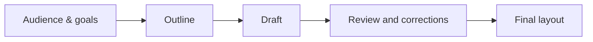

# 06 · Prompt Engineering Laboratory

> **Your mission:** Stop treating prompts as magic phrases. Treat them as **experimental designs**: make a prediction, test alternatives, inspect the output, and document what changed.

**Format:** practical workbook · **Four laboratory assignments** · **Core skills:** prompt comparison, chaining, branching, and tool-assisted workflows

---

## The laboratory at a glance

| Lab | Core technique | Main deliverable |
|:--:|---|---|
| **1** | Zero-shot vs few-shot vs structured stepwise analysis | **24 model runs**, comparison table, and written evaluation |
| **2** | Prompt chaining | A **5–7-page** beginner's guide to renewable energy, including intermediate drafts |
| **3** | Tree-of-Thought-style exploration | A **10-year** traffic reduction strategy with at least three evaluated alternatives |
| **4** | Generate-Knowledge, meta prompting, and ReAct | An evidence-aware comparison of AI approaches in medical diagnostics, plus reusable prompts |

The assignments should record not only final answers, but also the **prompts used to obtain them**. The goal is a reproducible experiment.

## Toolkit: ten prompting patterns

Before beginning, distinguish the main techniques.

| Technique | Principle | Best starting point |
|---|---|---|
| **Zero-shot** | Give the task without solved examples. | Straightforward, familiar requests. |
| **Few-shot** | Include a small set of demonstrations. | Stable labels, style, or output format. |
| **Chain-of-Thought-style prompting** | Request a structured explanation of the solution steps. | Multi-stage analysis that needs justification. |
| **Meta prompting** | Create a reusable prompt template. | Repeating a workflow with new inputs. |
| **Self-consistency** | Compare several independently generated candidates. | Tasks where converging outputs offer a useful cross-check. |
| **Generate-Knowledge** | Produce a preliminary knowledge outline before the final task. | Organizing unfamiliar subject matter. |
| **Prompt chaining** | Feed one stage's output into the next. | Long documents and multi-stage workflows. |
| **Tree of Thought** | Develop and evaluate several possible branches. | Planning and strategic trade-offs. |
| **ReAct** | Alternate task decisions with external retrieval or action. | Questions requiring tools and changing evidence. |
| **Settings control** | Adjust role instructions, output budget, or sampling behavior. | Making runs comparable or outputs appropriately bounded. |

### A minimal prompt formula

```text
TASK      What should be done?
CONTEXT   Which information is available?
FORMAT    What should the result look like?
RULES     Which constraints must be followed?
CHECK     How will we judge success?
```

A prompt like “Tell me about renewable energy” is a starting idea. A prompt that specifies the audience, scope, evidence, section structure, and success criteria is an experimental input.

### Basic experimental discipline

For a fair comparison, keep the **model, source inputs, and evaluation criteria** fixed whenever possible. Record model and relevant settings (such as temperature) if exposed by your interface.

Do not rely solely on the model's declaration that it has performed a check. Save evidence: the output, test result, retrieved source, or reviewer assessment.

---

# Lab 1 · Which prompting strategy reasons most accurately?

## Research question

Does adding demonstrations—and then requiring a short, structured explanation—improve a model's ability to recognize **logical fallacies** in short arguments?

We will compare **three prompt variants for eight cases**:

$$
8\ \text{cases}\times 3\ \text{strategies}=\boxed{24\ \text{runs}}.
$$

## 1.1 The eight argument cases

Analyze the following statements. Some contain a reasoning error; one is intended as a sound example.

**Case A**  
“Sales started falling after we introduced a new logo. This proves that the logo change discouraged customers.”

**Case B**  
“This supplement must work because a famous actor said in an interview that it made them feel great.”

**Case C**  
“I met two rude waiters at this restaurant chain. Clearly, the entire company has terrible staff.”

**Case D**  
“If we allow students to use phones in class, within a year nobody will pay attention and the education system will collapse.”

**Case E**  
“If we do not vote for this bill, our economy will collapse catastrophically and we will all lose our savings.”

**Case F**  
“We should not listen to his tax-reform proposal because he changed jobs twice within one year.”

**Case G**  
“Either you support a complete ban on internal-combustion cars, or you do not care about the environment at all.”

**Case H**  
“A study involving 10,000 people indicates that regular physical activity reduces the risk of heart disease. Therefore, it is worth introducing programs that encourage older adults to exercise.”

For educational comparison, use these possible labels: *false cause, appeal to authority, hasty generalization, slippery slope, appeal to fear, ad hominem, false dilemma,* and *no clear fallacy*. Treat the “no clear fallacy” category as a judgment about the **argument's form**, not independent verification of its cited evidence.

## 1.2 Strategy A: zero-shot

Use a direct instruction with no labeled examples.

```text
Analyze the argument below.
Choose exactly one label from:
false cause, appeal to authority, hasty generalization,
slippery slope, appeal to fear, ad hominem,
false dilemma, no clear fallacy.

Return:
1. Label
2. A one- or two-sentence justification
3. A confidence rating: low / medium / high

Argument:
[INSERT CASE]
```

This provides a baseline for comparison.

## 1.3 Strategy B: few-shot

Use the same final task but add **two or three demonstrations**. For example:

```text
Example 1
Argument: "This method worked for my neighbor, so it always works."
Label: hasty generalization
Reason: One person's experience cannot justify a universal claim.

Example 2
Argument: "Either we build a new stadium, or our city has no future."
Label: false dilemma
Reason: The argument excludes other possible solutions.

Example 3
Argument: "A singer endorsed the new medical treatment, so it must be effective."
Label: appeal to authority
Reason: Celebrity endorsement is not relevant medical evidence.

Now analyze this argument using the same format:
[INSERT CASE]
```

The examples should be **separate from the eight test cases**. Otherwise, the experiment risks measuring memorization of its own answers.

## 1.4 Strategy C: few-shot + structured justification

Keep the same examples, but change the requested output:

```text
Use the same definitions and examples above.

For the new argument, provide:
- Main claim (one sentence)
- Evidence offered by the argument (one sentence)
- Missing or unjustified inferential step (one sentence)
- Fallacy label, or "no clear fallacy"
- Brief conclusion (one sentence)

Argument:
[INSERT CASE]
```

This tests whether requiring **visible, checkable analytical steps** improves the final classification. A long explanation is not automatically better; assess whether its reasoning actually supports the label.

## 1.5 Record all 24 experiments

| Case | Zero-shot label | Few-shot label | Structured label | Reference category | Notes |
|:--:|---|---|---|---|---|
| A |  |  |  |  |  |
| B |  |  |  |  |  |
| C |  |  |  |  |  |
| D |  |  |  |  |  |
| E |  |  |  |  |  |
| F |  |  |  |  |  |
| G |  |  |  |  |  |
| H |  |  |  |  |  |

For each response, also inspect whether the justification **matches the label** and whether the output follows the requested format.

**Suggested evaluation rubric** (a practical addition to the source assignment):

| Criterion | 0 points | 1 point | 2 points |
|---|---|---|---|
| Classification | Incorrect | Plausible but ambiguous | Correct under the given reference scheme |
| Justification | Unsupported | Partially explanatory | Identifies the crucial reasoning issue |
| Format | Major deviations | Minor deviations | Exactly as specified |

You can report average scores by strategy and examine individual failures rather than only comparing a single total.

### Questions for the lab report

- Did few-shot examples improve classification or merely make formatting more consistent?
- Did the structured version identify the **missing inference** more accurately?
- Were any errors shared by all three strategies?
- Did the demonstrations introduce **anchoring** or bias toward certain labels?
- Could different temperatures or repeated runs change the conclusion?

**Deliverables:** all prompts, 24 responses, reference labeling, evaluation table, and a short comparative discussion.

---

# Lab 2 · Build a guide with prompt chaining

## The assignment

Produce a **5–7-page mini-textbook** entitled:

**“An Introduction to Renewable Energy for High-School Students.”**

The final document should explain the basic concepts, describe major renewable energy sources, compare advantages and disadvantages, include a short case study, and finish with a useful summary.

The exercise is not to generate the entire guide in one request. It is to design a **five-stage workflow** where each stage has a clear deliverable.

## 2.1 The five-stage chain

| Stage | Purpose | Deliverable |
|:--:|---|---|
| **1** | Define goals and audience | Scope, knowledge level, and learning outcomes |
| **2** | Design a detailed outline | Sections and subsection plan |
| **3** | Draft the guide | First complete manuscript |
| **4** | Critique and refine | Corrected draft with a change log |
| **5** | Unify the presentation | Final, consistently formatted mini-textbook |



## 2.2 Sample prompts for each stage

**Stage 1 — Understand the reader**

```text
Define the learning goals and assumed prior knowledge for a 5–7-page
high-school guide to renewable energy. Specify the intended depth,
the key concepts, and three common misconceptions to address.
```

**Stage 2 — Make the outline**

```text
Using the audience profile above, propose a detailed outline.
Include: definitions; solar, wind, hydro, and other major renewable
sources; advantages and limitations; one short case study; and a summary.
Allocate approximate space to each section.
```

**Stage 3 — Draft systematically**

```text
Write the guide following the approved outline and space allocation.
Use short paragraphs, plain English, informative headings, and
comparison tables where useful. Explain each technical term on first use.
Do not invent exact statistics or citations.
```

**Stage 4 — Review critically**

```text
Review the draft for clarity, missing concepts, internal contradictions,
and claims that require verification. Produce a concise change log,
then provide a revised version. Do not invent sources.
```

**Stage 5 — Polish the presentation**

```text
Format the revised guide as consistent educational Markdown.
Use a title, a short introduction, clear section levels, one comparison
table, a case-study boxquote, and a final key-takeaways section.
Preserve the content established by the reviewed draft.
```

### Quality check

Does the final result still serve the original **high-school audience**? Did the review catch inaccuracies? Can the reader explain both the **benefits and limitations** of renewable sources?

**Deliverables:** all five prompts, intermediate versions, review log, and final 5–7-page guide.

---

# Lab 3 · Explore alternatives with a Tree of Thought

## The assignment

A city of approximately **150,000 inhabitants** experiences heavy rush-hour congestion. Develop a strategy to reduce traffic over a **10-year horizon**.

The strategy should consider:

- public transport improvements;
- traffic organization and road management;
- infrastructure changes;
- economic incentives or charges;
- implementation speed, costs, and risks.

The defining requirement is **at least three independent candidate strategies** before selecting or combining the best ideas.

## 3.1 Create three branches

Start with meaningfully different directions, not three versions of the same plan.

```text
                         Reduce congestion
                                │
                ┌───────────────┼───────────────┐
                │               │               │
         A: Public transit   B: Traffic      C: Incentives &
            expansion         management       demand reduction
```

For each branch, describe:

1. major actions;
2. expected mechanisms of improvement;
3. prerequisites and constraints;
4. likely implementation obstacles;
5. what success would look like.

## 3.2 Compare branches using the same criteria

| Criterion | Branch A | Branch B | Branch C |
|---|---|---|---|
| Relative cost |  |  |  |
| Technical/political feasibility |  |  |  |
| Speed of deployment |  |  |  |
| Implementation risk |  |  |  |
| Potential long-term value |  |  |  |

Do not fabricate real budget figures. Where the prompt provides no cost data, use **explicit assumptions** and qualitative comparisons.

## 3.3 Prompt template

```text
You are preparing a 10-year mobility strategy for a city of about
150,000 inhabitants with severe rush-hour congestion.

Step 1: Propose at least three distinct strategies, including public
transport, traffic management, and economic or behavioral interventions.
Step 2: Describe the mechanism, prerequisites, and risks of each.
Step 3: Compare all strategies using the same criteria:
cost, feasibility, implementation time, and risk.
Step 4: Select the strongest plan or justified combination.
Step 5: Present a phased roadmap: years 1–2, 3–5, and 6–10.

Distinguish assumptions from facts. Do not invent local statistics.
Provide a decision table and a compact strategy diagram.
```

The aim is **exploration and evaluation**, not to generate the longest possible discussion. Good branch selection requires a transparent comparison of trade-offs.

**Deliverables:** at least three developed branches, comparison table, selection rationale, diagram, and detailed 10-year roadmap.

---

# Lab 4 · Research workflows: knowledge, templates, and actions

## The assignment

Build a comparative report on three families of AI techniques used in medical diagnostics:

1. **Convolutional neural networks (CNNs)**
2. **Transformer-based models**
3. **Classical machine learning**, including **SVM** and **Random Forest**

Cover typical uses, strengths and weaknesses, ethical risks, and **three realistic diagnostic scenarios**, such as X-ray image analysis, laboratory-test classification, and disease-risk prediction.

This is an **educational research exercise**, not a request for clinical recommendations or a real diagnostic system.

## 4.1 Stage A — Generate-Knowledge

Generate an initial knowledge map before composing the report.

```text
Create a structured knowledge outline comparing CNNs, transformers,
SVM, and Random Forest for medical-diagnostic research.
For each approach, define the mechanism, typical data types,
advantages, limitations, and evaluation concerns.
Separate general background from statements needing source verification.
```

The output is a **research scaffold**, not verified evidence. Any model-generated claim about clinical effectiveness must be checked against credible research before being used in the report.

## 4.2 Stage B — Meta prompting

Build a reusable report-generating template:

```text
Create a reusable prompt template for a comparative research report.
It must accept:
[TECHNOLOGIES], [APPLICATION DOMAIN], [SCENARIOS],
[EVALUATION CRITERIA], and [SOURCE MATERIAL].

Require consistent sections: definitions, mechanisms, applications,
comparative strengths and weaknesses, ethics, scenario analysis,
limitations of evidence, and conclusions.
The template must distinguish supplied evidence from unverified claims.
```

This turns a one-off prompt into a **repeatable method**.

## 4.3 Stage C — ReAct-style research

Model the workflow as a cycle of evidence gathering and revision:

```text
Identify a claim needing support
          ↓
Search or retrieve relevant evidence
          ↓
Inspect what the evidence actually supports
          ↓
Update the comparison and note uncertainty
          ↓
Continue, or conclude when the evidence is sufficient
```

**Example questions to research:**

- Which input data types are appropriate for each technique?
- What data volume and labeling requirements commonly arise?
- How are sensitivity, specificity, or other evaluation measures reported?
- How might data bias, privacy, or distribution shift affect deployment?

The application must actually have access to search or retrieval tools for this to constitute a **tool-assisted** workflow. Text merely *describing* a search is not the same as performing one.

## 4.4 Compare three scenarios consistently

| Scenario | CNNs | Transformers | Classical ML |
|---|---|---|---|
| **Medical images (e.g., X-ray)** |  |  |  |
| **Classification from structured test data** |  |  |  |
| **Disease-risk prediction** |  |  |  |

For each cell, consider *suitability, data needs, interpretability, practical limitations,* and *evidence quality*. Do not claim that one family is universally superior.

### Ethics and reliability checklist

- [ ] Data privacy and consent are considered.
- [ ] Bias and demographic or site-dependent performance are addressed.
- [ ] Validation is separated from training performance.
- [ ] False positives and false negatives are considered.
- [ ] Interpretability and clinical accountability are discussed.
- [ ] Claims about diagnostic accuracy are tied to verifiable studies.

**Deliverables:** the Generate-Knowledge prompts and results, a reusable metaprompt, the ReAct-style evidence-gathering workflow, and a comparative report with three scenarios.

---

## Reference annotations for Lab 1

The source exercise uses the following intended labels. They can serve as a reference when reviewing the experiments, although real argument analysis may sometimes require additional evidence or nuance.

| Case | Intended category | The core issue |
|:--:|---|---|
| **A** | False cause | Temporal sequence alone does not establish causation. |
| **B** | Appeal to authority | A celebrity's testimonial is not expert evidence. |
| **C** | Hasty generalization | Two examples do not justify a claim about all employees. |
| **D** | Slippery slope | A catastrophic chain of events is asserted without sufficient support. |
| **E** | Appeal to fear | A frightening outcome is used as a persuasive substitute for evidence. |
| **F** | Ad hominem | The person's job changes do not evaluate their tax proposal. |
| **G** | False dilemma | The argument excludes reasonable intermediate positions. |
| **H** | No clear fallacy (intended) | Evidence is cited in support of a proportionate recommendation, though the study itself remains unverified here. |

## Final submission checklist

- [ ] Every laboratory includes the **exact prompts** actually used.
- [ ] Intermediate outputs and revisions are preserved where required.
- [ ] Tables compare alternatives using **consistent criteria**.
- [ ] Facts and source-backed claims are distinguished from assumptions.
- [ ] The final documents are formatted clearly in Markdown.
- [ ] The conclusions discuss both **successes and failure modes** of the tested techniques.

> **Final lesson:** Prompt engineering becomes a science when you can explain **what you changed, why you changed it, how you evaluated it, and whether it improved the result**.

**Back to:** [01 · Introduction](01-introduction.md) · [05 · Prompt Content and RAG](05-prompts-context-and-rag.md)
